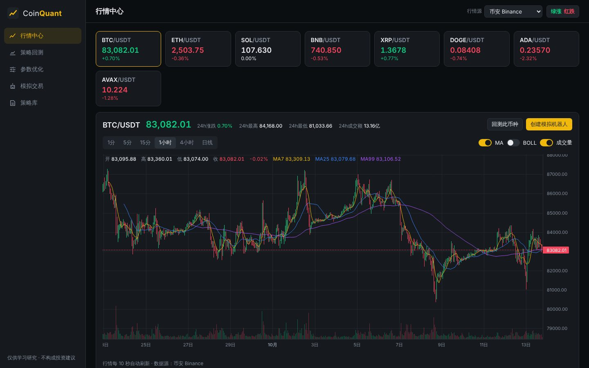
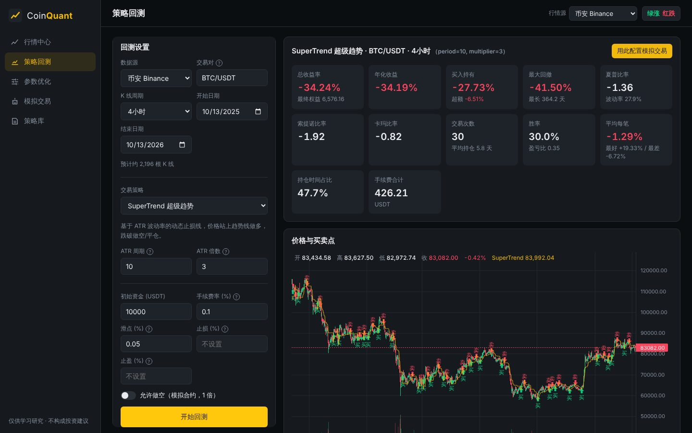
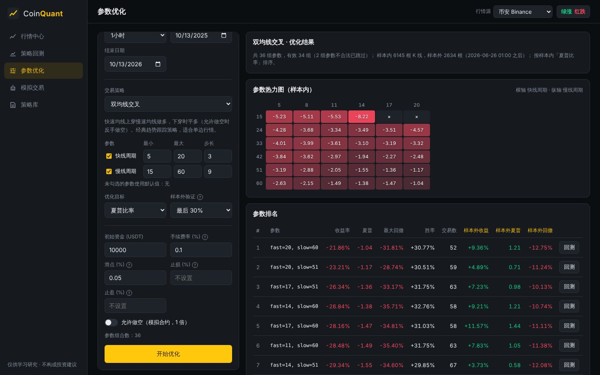
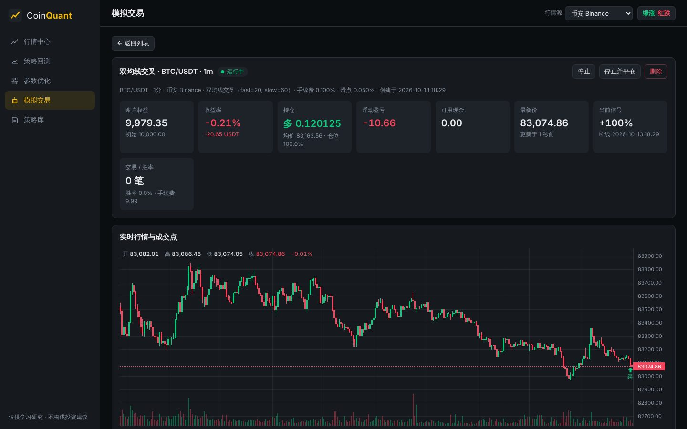

# CoinQuant · 虚拟货币量化交易平台

一个开箱即用的加密货币量化交易网站：**实时行情 → 策略回测 → 参数优化 → 模拟交易** 全流程。
后端 Python（FastAPI + pandas），前端 React + TradingView Lightweight Charts。

> ⚠️ 本项目仅用于量化策略的学习与研究。所有交易均为**模拟撮合**，不会向交易所下真实订单，不构成任何投资建议。



## 功能

| 模块 | 说明 |
| --- | --- |
| **行情中心** | 主流币种实时报价（10 秒刷新）、K 线图（1 分钟 ~ 日线）、MA / BOLL / 成交量指标 |
| **策略回测** | 9 个内置策略；计入手续费与滑点；支持做空、止损、止盈；输出 20+ 项绩效指标、买卖点、权益曲线、回撤曲线和逐笔交易明细 |
| **参数优化** | 参数网格批量回测，按夏普/收益/卡玛等目标排序；双参数热力图；**样本外验证**识别过拟合；一键回测任意参数组合 |
| **模拟交易** | 创建策略机器人，用交易所实时行情驱动、虚拟资金撮合；后台 7×24 运行，服务重启后自动恢复；持仓、成交、权益曲线、运行日志一目了然 |
| **策略库** | 全部策略说明与参数范围，一键进入回测 / 优化 / 模拟交易 |

**数据源**：币安 Binance、欧易 OKX 的公开行情接口（无需 API Key），以及完全离线的**模拟数据**（无法访问交易所时用于演示）。
历史 K 线会缓存到本地 SQLite，同一区间只需拉取一次。

**内置策略**：双均线交叉、EMA 均线交叉、MACD 金叉死叉、海龟通道突破、SuperTrend 超级趋势、RSI 超买超卖、布林带均值回归、动态网格交易、买入持有（基准）。

| 策略回测 | 参数优化 | 模拟交易 |
| --- | --- | --- |
|  |  |  |

## 快速开始

> 💡 `http://localhost:8000` 指的是**你自己的电脑**。必须先在电脑上把程序启动起来，这个地址才能打开。

### 方式一：一键启动（推荐，只需安装 Python）

1. 安装 **Python 3.11 或更高版本**：<https://www.python.org/downloads/>
   - Windows 安装时务必勾选 **“Add python.exe to PATH”**。
2. 下载并解压项目：
   - **发布包** `coinquant-release.zip`：已包含构建好的前端页面，**不需要安装 Node.js**；
   - 或直接下载 / 克隆本仓库源码：此时还需安装 [Node.js 18+](https://nodejs.org)，首次启动会自动构建前端。
3. 启动：
   - **Windows**：双击 `start.bat`
   - **macOS / Linux**：打开“终端”，进入解压后的文件夹，运行 `bash start.sh`
     （macOS 可以输入 `cd ` 加一个空格，再把文件夹拖进终端窗口，按回车）
4. 首次启动会自动安装依赖（约 1~3 分钟），完成后浏览器会自动打开 <http://127.0.0.1:8000>。
   使用期间**不要关闭这个命令行窗口**，关闭窗口或按 `Ctrl+C` 即停止。

也可以直接运行 `python run.py`（`--port 8001` 换端口，`--no-browser` 不自动打开浏览器）。

### 方式二：Docker

```bash
docker compose up -d --build
# 打开 http://localhost:8000
```

数据（SQLite）保存在 `./data` 目录。

### 方式三：手动运行（开发者）

需要 Python 3.11+ 与 Node.js 18+。

```bash
# 1. 后端
cd backend
python -m venv .venv && source .venv/bin/activate   # Windows: .venv\Scripts\activate
pip install -r requirements.txt
uvicorn app.main:app --port 8000

# 2. 前端（另开一个终端）
cd frontend
npm install
npm run dev
# 打开 http://localhost:5173 （/api 请求会代理到 8000 端口）
```

生产部署时执行 `cd frontend && npm run build`，后端会自动托管 `frontend/dist`，只需访问 `http://localhost:8000`。

### 运行测试

```bash
cd backend
pip install -r requirements-dev.txt
pytest
```

测试覆盖指标计算、撮合与记账、止损止盈、做空、**所有策略的未来函数检测**（截断数据与完整数据的信号必须一致）、参数优化与全部 API（含模拟交易机器人生命周期）。

## 配置

通过环境变量调整（均有默认值）：

| 变量 | 默认值 | 说明 |
| --- | --- | --- |
| `DEFAULT_SOURCE` | `binance` | 默认数据源：`binance` / `okx` / `synthetic` |
| `BINANCE_BASE_URL` | `https://data-api.binance.vision` | 币安行情接口地址（官方公开行情镜像，可访问地区更广） |
| `OKX_BASE_URL` | `https://www.okx.com` | OKX 接口地址 |
| `HTTPS_PROXY` | – | 网络受限时可配置代理访问交易所 |
| `QUANT_DATA_DIR` | `backend/data` | SQLite 数据目录 |
| `MAX_BARS` | `30000` | 单次回测最多 K 线数量 |
| `MAX_OPT_COMBOS` | `500` | 单次优化最多参数组合数 |
| `BOT_POLL_SECONDS` | `10` | 模拟交易机器人轮询行情间隔（秒） |

> 如果行情加载失败（所在地区或网络无法访问币安/OKX），可在页面右上角切换行情源：币安、OKX 或「模拟数据（离线）」，模拟数据无需联网即可体验全部功能。

## 回测规则

为保证回测结果可信，引擎遵循以下约定：

- **无未来函数**：第 *i* 根 K 线收盘后产生信号，在第 *i+1* 根 K 线**开盘价**成交。
- **交易成本**：每笔成交按手续费率扣费，并按滑点向不利方向调整成交价。
- **仓位**：策略输出目标仓位（-1 ~ 1，即权益的比例）；现货不加杠杆，买入受可用资金约束；做空为 1 倍模拟合约。
- **止损/止盈**：相对持仓均价，用 K 线内最高/最低价触发，跳空时按开盘价成交；同一根 K 线同时触发时保守地按止损处理。止损后需等策略信号变化才会再次入场。
- **期末平仓**：回测结束时按最后收盘价平掉持仓，计入交易统计。
- **年化**：加密货币 7×24 交易，按 365.25 天年化，无风险利率取 0。

模拟交易沿用同一套撮合与风控逻辑：每根 K 线收盘时计算信号并按最新价成交，止损止盈在每次轮询时用最新价检查。

## 项目结构

```
backend/
  app/
    main.py            # FastAPI 路由、静态文件托管
    config.py          # 配置
    db.py              # SQLite（K 线缓存、机器人、成交、权益、日志）
    data/              # 数据源：binance / okx / synthetic + 缓存服务
    indicators.py      # 技术指标：SMA/EMA/RSI/MACD/BOLL/ATR/唐奇安/SuperTrend
    strategies/        # 策略框架与内置策略
    engine.py          # 撮合记账、回测引擎、绩效指标
    optimizer.py       # 参数网格优化 + 样本外验证
    paper.py           # 模拟交易机器人（后台协程）
  tests/               # pytest 测试
frontend/
  src/
    pages/             # 行情、回测、优化、模拟交易、策略库
    components/        # 图表、表单、通用组件
    api.ts             # 后端 API 客户端
```

## 添加自定义策略

在 `backend/app/strategies/builtin.py` 中编写一个函数，输入 K 线 `DataFrame`（列：`ts, open, high, low, close, volume`）和参数字典，返回每根 K 线收盘后的目标仓位：

```python
def my_strategy(df, p):
    fast = ind.ema(df["close"], p["fast"])
    slow = ind.ema(df["close"], p["slow"])
    target = (fast > slow).astype(float)          # 1 = 满仓做多，0 = 空仓，-1 = 满仓做空
    return StrategyOutput(target=target, overlays={"EMA快": fast, "EMA慢": slow})
```

然后把它加入 `STRATEGIES` 列表（声明名称、说明和参数范围），前端会自动出现在策略列表、优化和模拟交易中。
只要只使用当前及之前的数据，`tests/test_strategies.py` 会自动对新策略做未来函数检测。

## API

启动后访问 `http://localhost:8000/docs` 查看交互式 API 文档，主要接口：

- `GET /api/meta` — 数据源、周期、策略及参数定义
- `GET /api/klines`、`GET /api/tickers` — 行情
- `POST /api/backtest` — 回测
- `POST /api/optimize` — 参数优化
- `GET/POST /api/bots`、`GET /api/bots/{id}`、`POST /api/bots/{id}/start|stop`、`DELETE /api/bots/{id}` — 模拟交易

## 后续可扩展方向

- 接入交易所私有 API 实盘下单（需妥善保管 API Key、增加风控与鉴权）
- 多币种组合与资金分配
- 用户登录与多账户隔离
- 策略代码在线编辑

## 免责声明

本项目仅供学习和研究使用。历史回测与模拟交易结果不代表未来收益；虚拟货币价格波动剧烈，请理性看待，风险自担。
图表由 [TradingView Lightweight Charts™](https://www.tradingview.com/) 提供。
